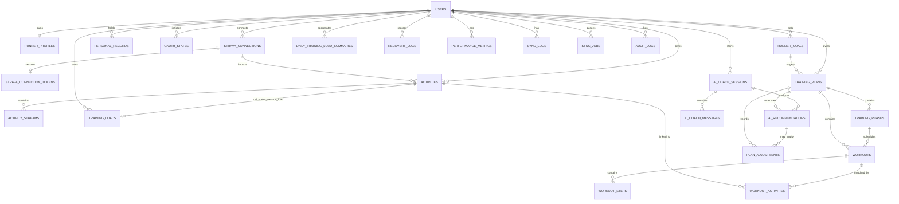

# Entity Relationship Diagram
## Personal Running Coach

**Reconciled:** 2026-11-24 (`Milestone 0` final remediation: composite cross-user FKs & two-layer training load model)

## 1. Logical ERD

## 2. Entity Responsibilities

| Entity | Responsibility | Access Boundary |
|---|---|---|
| `auth.users` | Supabase Auth identity | Managed by Supabase Auth |
| `runner_profiles` | Main runner profile, timezone, availability, baseline | User RLS (`auth.uid() = user_id`) |
| `runner_goals` | Primary and secondary running goals | User RLS |
| `personal_records` | Verified or baseline-entered PRs (5K, 10K, HM, Marathon, custom) with provenance | User RLS |
| `oauth_states` | Short-lived server-side OAuth CSRF state bound to initiating user | Server / `service_role` only |
| `strava_connections` | Provider athlete identity, granted scopes, connection lifecycle status | User RLS (`SELECT` safe metadata only) |
| `strava_connection_tokens` | Encrypted Strava OAuth access/refresh tokens and expiry | Server / `service_role` only (zero client RLS access) |
| `activities` | Actual recorded running/training activities (canonical units) | User RLS |
| `activity_streams` | Optional lazy-loaded time-series stream payloads | User RLS |
| `training_loads` | Strictly per-activity session training load (`1:1` per activity; `srpe`, `hr_trimp_estimate`, `duration_estimate`) | User RLS |
| `daily_training_load_summaries` | Deterministic per-day aggregate load and rolling 7-day acute / 28-day chronic snapshots | User RLS |
| `training_plans` | Plan lifecycle, target, version, methodology provenance | User RLS |
| `training_phases` | Periodized sections inside a training plan | User RLS |
| `workouts` | Planned training sessions on calendar | User RLS |
| `workout_steps` | Ordered structured steps inside a workout | User RLS |
| `workout_activities` | Explicit link between planned workout and actual activity | User RLS |
| `recovery_logs` | Daily manual recovery inputs per local calendar date | User RLS |
| `performance_metrics` | Calculated period metrics with completeness and version | User RLS |
| `ai_coach_sessions` | AI weekly review / Q&A / goal review context | User RLS |
| `ai_coach_messages` | User and assistant messages with OpenRouter metadata | User RLS |
| `ai_recommendations` | Structured AI insights and plan adjustment proposals tied to a plan & version | User RLS |
| `plan_adjustments` | Applied plan/calendar adjustments with before/after snapshots | User RLS |
| `sync_logs` | User-visible sync/import history and safe error summaries | User RLS |
| `sync_jobs` | Durable PostgreSQL job queue (`pending`/`processing`/`retry_wait`/`completed`/`failed`) | Server / `service_role` write; safe user `SELECT` |
| `audit_logs` | Immutable audit trail of critical user/system mutations | User RLS (`SELECT` own logs; server-controlled inserts) |

## 3. Relationship Constraints & Cross-User Integrity

- **Database-enforced relational ownership (beyond RLS):** Every parent table referenced by another user-owned table exposes `UNIQUE (id, user_id)`, and child tables enforce composite foreign keys `(referenced_id, user_id)` referencing `(id, user_id)` so cross-user links are structurally impossible even in `service_role` operations.
- **One profile per user:** `runner_profiles.user_id` is unique.
- **One active primary goal per user:** Enforced via partial unique index on `runner_goals (user_id) WHERE priority = 'primary' AND status = 'active'`.
- **One active training plan per user:** Enforced via partial unique index on `training_plans (user_id) WHERE status = 'active'`.
- **Planned vs. actual separation:** `activities` are never child rows of `workouts`. `workout_activities` links them via composite FKs (`(workout_id, user_id)` and `(activity_id, user_id)`) with `UNIQUE (workout_id, activity_id)` plus partial unique indexes enforcing at most one `is_primary = true` match per `workout_id` and per `activity_id`. Unlinking deletes only the `workout_activities` row.
- **Activity deduplication:** External activity uniqueness is enforced per user and provider (`UNIQUE (user_id, provider, external_activity_id) WHERE external_activity_id IS NOT NULL`) so disconnecting and reconnecting Strava never duplicates historical activities.
- **Two-layer training load model:** `training_loads` stores strictly per-activity session load (`UNIQUE (activity_id)`, updated in-place on RPE changes). `daily_training_load_summaries` stores deterministic per-day aggregates and 7-day acute / 28-day chronic rolling snapshots (`UNIQUE (user_id, summary_date)`), preserving rest days and multi-session days without duplicate records.
- **Token isolation & owner consistency:** `strava_connection_tokens` references `strava_connections(id, user_id)` with `ON DELETE CASCADE`, guaranteeing the token owner matches the connection owner while isolating encrypted tokens from client RLS. `activities.strava_connection_id` uses column-scoped `ON DELETE SET NULL (strava_connection_id)` so user-retained activity history survives disconnection.
- **AI recommendation plan provenance:** `ai_recommendations` links to both `ai_coach_sessions(id, user_id)` and `training_plans(id, user_id)` alongside `based_on_plan_version`, and `plan_adjustments` links to both `training_plans(id, user_id)` and `ai_recommendations(id, user_id)`.
- **Account deletion:** Deleting `auth.users` cascades user-owned domain tables (`ON DELETE CASCADE`) after server-side Strava deauthorization.

## 4. Modeling Notes

- Use UUID primary keys across all domain tables.
- Store all timestamps as `timestamptz` in UTC; store `timezone_name` (IANA, e.g. `Asia/Jakarta`) on `runner_profiles`, `activities`, and `recovery_logs` for local-date calendar and `missed` derivation.
- Store canonical distance in meters, duration in seconds, and weight in kilograms.
- Keep raw provider payloads and high-resolution streams out of primary `activities` rows; lazy-load streams and evaluate Supabase Storage if large stream payloads become frequent post-MVP.
- Store derived analytics and load metrics with explicit `method`, `calculation_version`, `source_data`, `is_estimated`, and `completeness` metadata.
