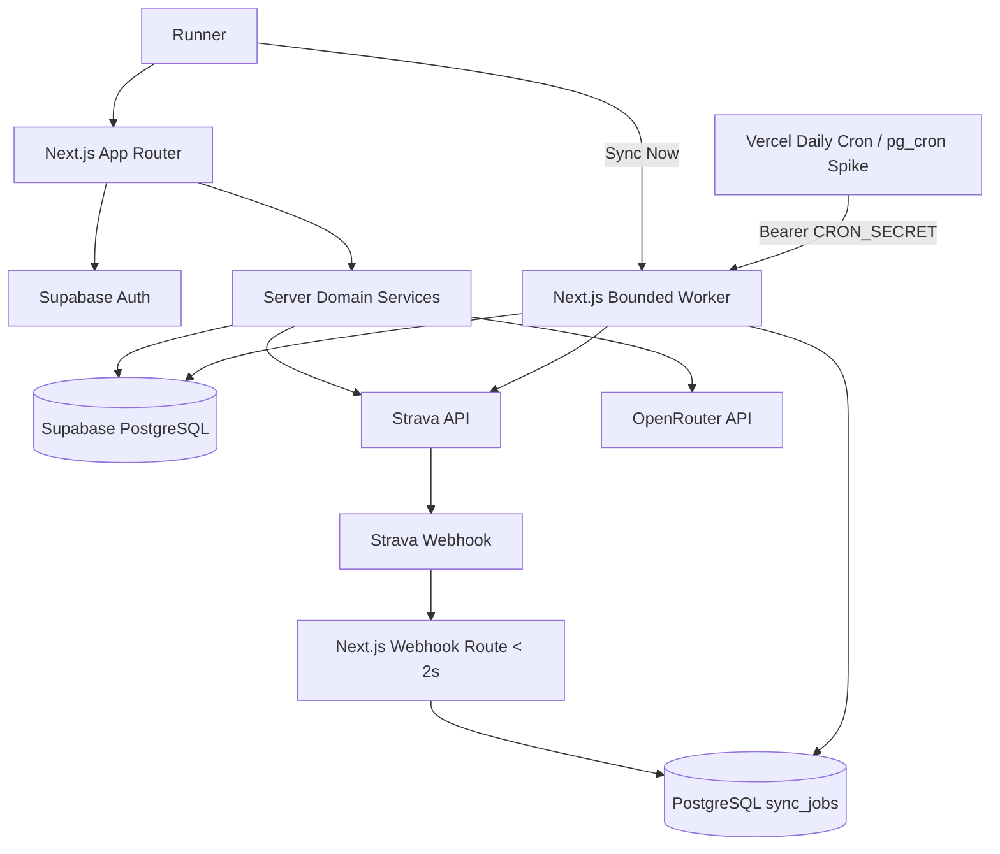
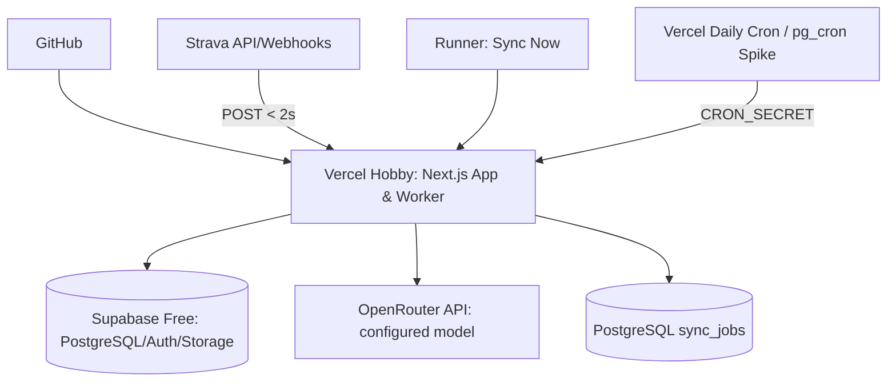

# System Architecture
## Personal Running Coach

## 1. Architecture decision

Use a **modular monolith** built with Next.js App Router, backed by Supabase managed services. This provides a simple deployment path for a personal-use MVP while keeping domain logic modular and background processing durable.

No Laravel, no separate backend service, and no Redis are assumed for MVP.

## 2. Technology stack

| Layer | Technology | Responsibility |
|---|---|---|
| Web app | Next.js App Router | Routes, layouts, server rendering |
| Language | TypeScript strict | Type safety |
| UI | Tailwind CSS, shadcn/ui, Lucide React | Styling, components, functional icons |
| Charts | Recharts | Analytics visualizations |
| Auth/data client | `@supabase/ssr`, `@supabase/supabase-js` | Session and DB access |
| Database | Supabase PostgreSQL | Relational data & atomic RPCs |
| Authorization | Supabase RLS | Row ownership & server-only token isolation |
| Files | Supabase Storage | Optional exports/assets |
| Background Queue | PostgreSQL `sync_jobs` table | Durable job queue (`FOR UPDATE SKIP LOCKED`) |
| Worker Execution | Next.js server worker (`server/jobs/`) | Bounded batch processing (single TS codebase) |
| Scheduling | Vercel Hobby Cron (1x/day) + `pg_cron`/`pg_net` (spike) | Scheduled reconciliation & queue drain |
| External activity | Strava API (`activity:read_all`) | Activity source |
| AI gateway | OpenRouter OpenAI-compatible API | Model-agnostic inference gateway; free models prioritized |
| Hosting | Vercel Hobby | Next.js deployment |
| Tests | Vitest, Playwright | Unit/integration/E2E |

Check current provider quotas, policies, pricing, and runtime limits before implementation and deployment. A free-first target is not a guarantee of permanent zero cost.

## 3. High-level architecture



## 4. Application structure

Suggested repository structure:

```text
personal-running-coach/
├── app/
│   ├── (auth)/
│   ├── (app)/
│   │   ├── dashboard/
│   │   ├── calendar/
│   │   ├── activities/
│   │   ├── analytics/
│   │   ├── recovery/
│   │   ├── coach/
│   │   └── settings/
│   ├── api/
│   │   ├── integrations/strava/callback/
│   │   ├── webhooks/strava/
│   │   └── ...
│   └── layout.tsx
├── components/
│   ├── ui/
│   └── shared/
├── features/
│   ├── runner/
│   ├── training/
│   ├── calendar/
│   ├── activities/
│   ├── analytics/
│   ├── recovery/
│   └── ai-coach/
├── server/
│   ├── auth/
│   ├── domain/
│   │   ├── runner/
│   │   ├── training/
│   │   ├── activities/
│   │   ├── analytics/
│   │   ├── recovery/
│   │   └── ai-coach/
│   ├── integrations/
│   │   ├── strava/
│   │   ├── openrouter/
│   │   └── ai-provider/
│   ├── jobs/
│   ├── security/
│   └── db/
├── lib/
│   ├── supabase/
│   ├── validation/
│   └── utils/
├── supabase/
│   ├── migrations/
│   ├── functions/
│   └── seed.sql
├── tests/
│   ├── unit/
│   ├── integration/
│   └── e2e/
├── docs/
└── ...
```

`app/` should remain thin. Server Actions and Route Handlers are transport/adaptor layers, not locations for large business logic. Core rules belong in `server/domain`.

## 5. Request and mutation patterns

### Read
1. Server Component obtains authenticated user.
2. Server service validates ownership/context.
3. Supabase query executes with user-scoped session/RLS.
4. DTO is returned to UI.

### Mutation
1. UI submits typed input.
2. Server Action validates input using Zod.
3. Server verifies session and ownership.
4. Domain service applies business rules.
5. Database transaction/RPC used where atomicity is required.
6. Audit event is recorded.
7. UI revalidates relevant data.

### External API
- Provider calls occur server-side only.
- Use adapter interfaces to isolate Strava and OpenRouter contracts.
- Set timeouts and retry only safe/idempotent operations.
- Redact secrets from logs.

## 6. Strava integration design

### OAuth
- Generate cryptographically random `state`, hash it (SHA-256), and persist in server-only `oauth_states` bound to the initiating `user_id` and expiry.
- Request `activity:read_all` scope (`DEC-02`) so both public and private ("Only You") running activities sync, clearly disclosed in the UI.
- Validate and consume `state` on callback.
- Exchange authorization code server-side.
- Encrypt access/refresh tokens with AES-256-GCM (`v1:<iv>:<tag>:<ciphertext>`) before persistence in isolated `strava_connection_tokens` (`service_role` only).
- Store granted scopes and metadata in `strava_connections`; never expose tokens to browser code or logs.

### Sync
- Initial import and incremental sync run as bounded `sync_jobs`.
- Use pagination with baseline page size `50` (`per_page=50`) fetching activity summaries first; lazy-load optional detail/streams on demand to protect Strava rate limits and DB storage.
- Deduplicate using `UNIQUE (user_id, provider, external_activity_id)`.
- Normalize provider data to canonical units (meters, seconds).
- Upsert provider-owned fields without overwriting local manual fields (`session_rpe`, `local_notes`, manual `workout_activities` matches).
- Record sync outcomes and safe errors in `sync_logs`.
- Reconcile daily via scheduled cron (and manually via `Sync Now`) in case webhook events are missed.

### Token handling
- Refresh with a configurable buffer before expiry (baseline: 5 minutes).
- On 401, attempt refresh once where appropriate; if unsuccessful, mark `strava_connections.status = 'reauthorization_required'`.
- On 429, respect `Retry-After` and track Strava `X-RateLimit-*` / `X-ReadRateLimit-*` headers.
- Retry transient failures with max 5 attempts: staged delays of `30s`, `60s`, `120s` for attempts 1-3, then bounded exponential backoff with jitter (`240s`, `480s`) unless `Retry-After` specifies longer.

### Webhook
1. `GET` handler validates `hub.mode=subscribe` and `hub.verify_token` (`STRAVA_WEBHOOK_VERIFY_TOKEN`), echoing `hub.challenge` within Strava's 2-second limit.
2. `POST` handler validates `subscription_id` against `STRAVA_WEBHOOK_SUBSCRIPTION_ID`, verifies `owner_id` matches a known `strava_connections.provider_athlete_id`, and validates event shape.
3. Insert a minimal durable job into `sync_jobs` with a unique `idempotency_key` (ignoring duplicates).
4. Return `200 OK` quickly (< 2s); never perform token refresh, historical import, or Strava activity fetches inline.

### Hybrid operating mode & worker architecture (`DEC-04`)
To avoid maintaining duplicate TypeScript/Zod/AES-GCM logic across Node.js and Deno Edge Functions, MVP separates background processing into four explicit layers:

1. **Durable job storage:** PostgreSQL `sync_jobs` table (`pending` / `processing` / `retry_wait` / `completed` / `failed`, `attempts`, `max_attempts = 5`, `next_run_at`, `lease_expires_at`, `idempotency_key`, `error_classification`).
2. **Atomic job claiming:** PostgreSQL RPC `claim_sync_jobs(worker_id, batch_size, lease_seconds)` using `SELECT ... FOR UPDATE SKIP LOCKED` to claim due `pending`/`retry_wait` rows and safely reclaim stuck `processing` rows whose `lease_expires_at < now()`.
3. **Worker execution:** Single Next.js TypeScript worker (`server/jobs/sync-worker.ts`) processing a bounded batch per invocation (e.g., max 5-10 jobs or 1-2 Strava pages per run) within serverless execution limits.
4. **Worker triggering / scheduling (kept distinct from durability):**
   - **Verified guaranteed triggers:** User-triggered manual **`Sync Now`** (authenticated Server Action / Route Handler), **Webhook fast enqueue** (`< 2s` durable insert into `sync_jobs`), and **Vercel Hobby Daily Cron** (capped at **1x/day with timing jitter**, calling `/api/cron/sync-reconcile` with `Authorization: Bearer <CRON_SECRET>`).
   - **Explicit non-guarantees & platform limits:**
     - Do **not** describe the background pipeline as continuously running or guaranteed real-time merely because Vercel Cron or Supabase extensions exist.
     - Vercel Hobby Cron cannot execute more than once per day; sub-daily cron expressions fail deployment.
     - Supabase Free pauses after **7 days of inactivity**, halting `pg_cron` and causing webhook DB inserts to fail until manually restored in the Supabase Dashboard.
     - **Next.js `after()` is NOT a durable queue or guaranteed background execution mechanism** (serverless runtime termination can drop unawaited post-response work). Any optional post-response trigger must never be treated as a delivery guarantee.
   - **Milestone 3 Worker Spike (required before claiming sub-daily automation):** Verify `pg_cron` + `pg_net.http_post()` (or alternative supported trigger) against live Supabase Free + Vercel Hobby constraints using these **mandatory acceptance criteria**:
     1. Worker processes queued jobs without an active user session.
     2. Concurrent workers cannot claim the same unexpired job.
     3. Expired leases (`lease_expires_at < now()`) are recovered and completed safely.
     4. Worker failure mid-batch does not lose jobs.
     5. Retries and duplicate webhook events do not create duplicate `activities` rows.
     6. Any sub-daily automated trigger is proven with an actual end-to-end test in the deployed free-tier environment before being claimed as supported.
   - **MVP Fallback if sub-daily triggering fails or proves unreliable:** Operate strictly in **Webhook-Enqueue + 1x/Day Vercel Cron + Manual `Sync Now`** mode. Queued webhook events remain durably stored in `sync_jobs` and are processed either during the daily Cron reconciliation window or immediately whenever the runner clicks `Sync Now`.

## 7. Background jobs

Job fields in `sync_jobs`:
- `id`, `user_id`, `connection_id`, `provider`, `job_type`, minimal `payload` identifiers/cursors, `idempotency_key`.
- `status` (`pending` / `processing` / `retry_wait` / `completed` / `failed`), `attempts`, `max_attempts` (`5`).
- `next_run_at`, `locked_at`, `locked_by`, `lease_expires_at`.
- `error_classification`, `last_error_code`, `last_error_safe`, `finished_at`, `created_at`, `updated_at`.

Worker behavior:
- Claim jobs atomically via `claim_sync_jobs` lease RPC.
- Process a bounded batch per invocation (protecting Vercel function timeout and Strava 15-min quotas).
- Persist pagination cursors after each page so partial imports resume cleanly.
- Classify errors (`rate_limit`, `auth_required`, `transient_network`, `invalid_payload`, `permanent`).
- Dead-letter exhausted jobs (`failed`) and expose manual retry in Settings -> Integrations.

Potential jobs:
- `strava.initial_import`
- `strava.incremental_sync`
- `strava.activity_upsert`
- `strava.activity_delete`
- `metrics.recalculate_activity`
- `metrics.recalculate_period`
- `coach.recommendation_expire`
- `maintenance.token_check`

**Verified Free-Tier Operational Constraints (2026-11-24):**
- **Supabase Free:** 500 MB DB, 5 GB egress, **pauses after 7 days of inactivity** (which also halts `pg_cron` and causes webhook DB inserts to fail until manually unpaused in Supabase Dashboard).
- **Vercel Hobby:** Max 300s function duration, **1x/day Cron limit with timing jitter**, 100 GB Fast Data Transfer, personal/non-commercial use only.
- **Strava API:** 1 webhook subscription per Strava client ID; ~2s webhook response timeout; default ~100 reads/15min and ~1,000 reads/day (check `X-ReadRateLimit-Usage` headers).

## 8. OpenRouter AI integration

- Call OpenRouter only from server-side code.
- Use the OpenAI-compatible endpoint `https://openrouter.ai/api/v1` (for example, through the OpenAI TypeScript SDK) or the official OpenRouter SDK after dependency review.
- Keep `OPENROUTER_API_KEY` in server-side secrets.
- Keep `OPENROUTER_MODEL` and optional fallback model in server-side configuration.
- Select model variants that have passed structured-output and latency tests; free model availability and capabilities vary.
- Add bounded retries, timeouts, request budgets, result caching, and a deterministic non-AI fallback.
- Define strict input/output schemas.
- Pass aggregated, minimized data instead of full raw activity streams.
- Ask model for structured JSON.
- Validate with Zod.
- Reject malformed, stale, or unsupported proposals.
- Persist model/version and context snapshot where appropriate.
- Never give model direct DB credentials or unrestricted tool access.


### Production deployment topology



Vercel Hobby is intended for personal/non-commercial use. If the project becomes commercial or exceeds plan limits, review plan eligibility before continuing. No VPS, always-on worker, Redis, or production 9Router is required for MVP.

## 9. Security architecture

- Supabase Auth with server-verified session.
- RLS enabled on all user-owned tables.
- Server-only service role key.
- Strava and OpenRouter secrets stored in environment secrets.
- Encrypt Strava OAuth tokens at application layer.
- Validate OAuth state and webhook payloads.
- Validate ownership on every mutation.
- Use CSRF protections appropriate to the framework/session model.
- Rate-limit expensive AI and sync actions.
- Apply input validation and output encoding.
- Avoid logging secrets, route traces, or unnecessary personal details.
- Use audit logs for critical plan changes.
- Provide disconnect and data deletion workflows.

## 10. Environment variables

Example names only; never commit actual values:

```env
NEXT_PUBLIC_APP_URL=
NEXT_PUBLIC_SUPABASE_URL=
NEXT_PUBLIC_SUPABASE_ANON_KEY=
SUPABASE_SERVICE_ROLE_KEY=

STRAVA_CLIENT_ID=
STRAVA_CLIENT_SECRET=
STRAVA_TOKEN_ENCRYPTION_KEY=
STRAVA_WEBHOOK_VERIFY_TOKEN=
STRAVA_WEBHOOK_SUBSCRIPTION_ID=

OPENROUTER_API_KEY=
OPENROUTER_MODEL=
OPENROUTER_FALLBACK_MODEL=
OPENROUTER_SITE_URL=
OPENROUTER_APP_NAME=Personal Running Coach
AI_REQUEST_TIMEOUT_MS=20000
AI_MAX_REQUESTS_PER_DAY=
AI_MAX_TOKENS=

CRON_SECRET=
```

Only `NEXT_PUBLIC_` values are browser-exposed. Service role, Strava secrets, encryption key, webhook verify token/subscription ID, OpenRouter API key, and `CRON_SECRET` must remain server-side.

## 11. Deployment

- GitHub repository.
- Vercel project connected to GitHub.
- Supabase hosted project.
- Apply SQL migrations through controlled deployment workflow.
- Configure environment variables in Vercel and Supabase.
- Configure Strava callback and webhook URLs.
- Configure Cron/Edge Function only after validating current quotas.
- Monitor logs, database usage, egress, AI usage, and job failures.

## 12. Free-cloud operating model

Target initial spend: Rp0/$0 per month where provider terms and quotas allow. This is a target, not a guarantee or an unlimited/free forever promise.

Do not promise unlimited free usage. Review:
- Supabase database/storage/egress/function/cron quotas and inactivity policies.
- Vercel Hobby eligibility and usage limits.
- Strava API rate limits and application review/policy requirements.
- OpenRouter free model availability, rate limits, model capabilities, and provider privacy/retention policies.

Design for graceful degradation:
- Manual sync fallback.
- On-demand analytics calculation.
- Cached weekly AI summaries.
- Bounded imports.
- No always-on server requirement for MVP.

## 13. Observability

Track:
- Sync success/failure and last sync time.
- Queue depth and oldest job age.
- Retry counts and dead-letter jobs.
- Provider 401/429 rates.
- AI latency, schema validation failures, and usage.
- Database size and query latency.
- Error rates by feature.

Do not store raw credentials in observability tools.
